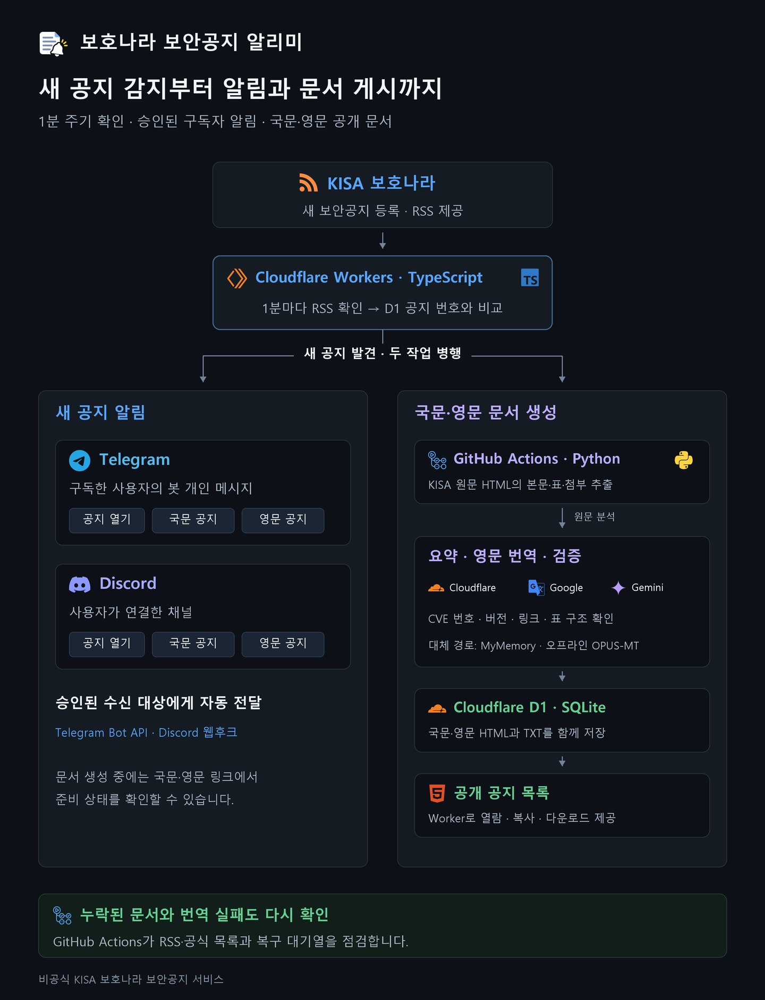
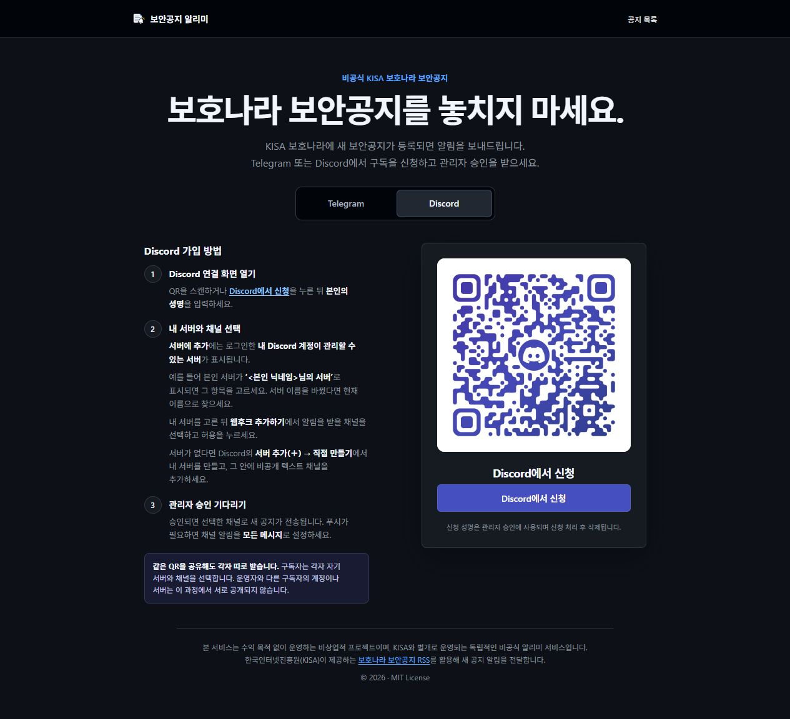
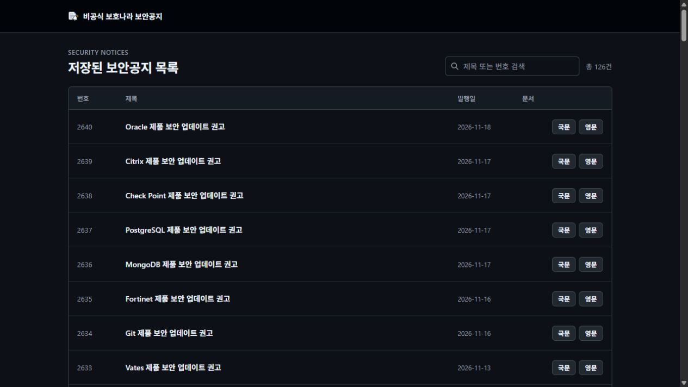
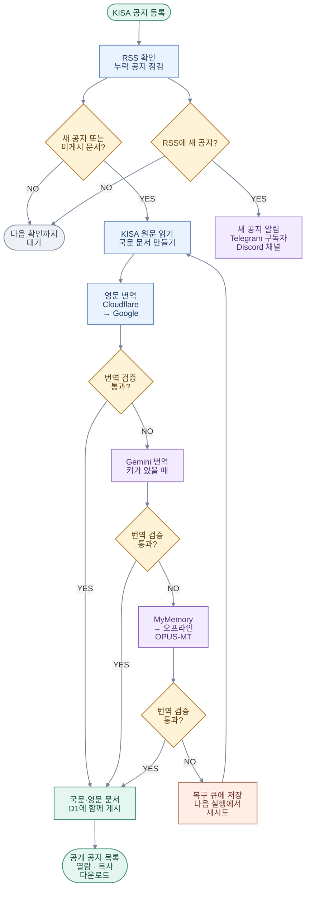

# 보호나라 보안공지 알리미

KISA 보호나라에 새 보안공지가 올라오면 Telegram 또는 Discord로 알려주는 비공식 서비스입니다. 알림은 관리자 승인 후 받을 수 있습니다. 공개 공지 목록에서는 가입 없이 공지를 찾아보고 국문·영문 문서를 읽을 수 있습니다.

[알림 신청](https://notice.bohonara.workers.dev/) · [공지 목록](https://notice.bohonara.workers.dev/notices/)

[구성도 편집 파일 · draw.io](docs/images/service-overview.drawio)

## 주요 기능

- **Telegram**에서 봇의 개인 메시지로 새 공지 알림을 받습니다.
- **Discord**에서 각자 연결한 채널로 새 공지 알림을 받습니다.
- **공개 공지 목록**에서 제목을 검색하고, 원문과 국문·영문 문서를 열거나 텍스트로 저장할 수 있습니다.

## 화면

**가입 페이지 · Discord 탭**

**공개 공지 목록**

## 공지 감지부터 번역·게시까지

Cloudflare나 Gemini에 필요한 키가 설정된 경우 해당 서비스를 시도합니다. 번역 검증에서는 문서의 제목·요약·본문과 CVE 번호, 버전, 링크 등 핵심 정보가 보존됐는지 확인합니다. 알림은 문서 게시와 별도로 Telegram 구독자와 구독자가 연결한 Discord 비공개 채널에 발송합니다. 문서가 준비되는 동안 국문·영문 링크에는 준비 상태가 표시됩니다.

## 문서

[설치·운영 안내](docs/operations.md) · [개인정보 처리 안내](PRIVACY.md) · [보안 정책](SECURITY.md) · [MIT 라이선스](LICENSE)
