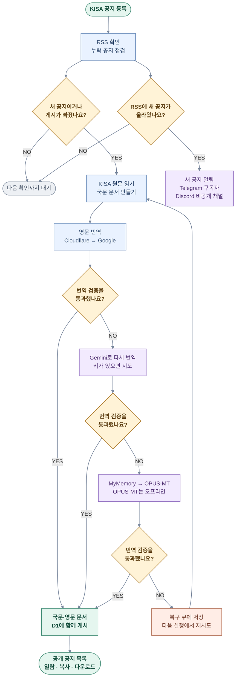

# KISA 승인형 Telegram · Discord 알림

KISA 보호나라 보안공지를 Telegram 개인 메시지와 Discord 비공개 채널로 전달하는 승인형 알림 서비스입니다. 공개 가입 페이지의 QR로 봇을 열고 본인의 성명을 제출하면 관리자가 가입 신청을 검토합니다. Telegram bot token과 관리자 ID는 Cloudflare Worker Secret으로 관리합니다. 신청·구독 데이터는 공개 저장소에 넣지 않습니다.

[비공식 KISA 보호나라 보안공지 알림 신청](https://notice.bohonara.workers.dev/)

## 주요 기능

- 반응형 가입 안내 페이지와 Telegram·Discord QR
- 관리자 개인 Telegram의 가입 승인·거절 버튼
- 시간당 신청·승인 대기·구독자 수 상한
- 일회용·다회용 만료 초대 링크도 보조 수단으로 유지
- `/start`, `/stop`, `/status`, `/help` 구독 명령
- 관리자 전용 `/applications`, `/approve`, `/reject`, `/reopen`, `/invite`, `/subscribers`, `/revoke`
- 구독자 수 상한 강제 적용(기본 50명)
- 한 번에 최대 20명씩 분할 발송
- 실패 지수 백오프 재시도
- 봇 차단·탈퇴 사용자의 구독 자동 정리
- KISA 기존 공지로 최초 상태를 만들고 과거 공지는 발송하지 않음
- Worker 주소에서 국문·영문 공지 열람, 복사, 다운로드

```text
GitHub Public 저장소 ──배포──> Cloudflare Worker
                                  ├─ 공개 가입 페이지 + Telegram·Discord QR
                                  ├─ Telegram·Discord 구독 신청과 관리자 승인
                                  ├─ KISA RSS 1분 확인
                                  └─ Cloudflare D1 (비공개 신청·구독 정보)
```

## 공지 감지부터 번역·게시까지



Cloudflare나 Gemini에 필요한 키가 설정된 경우 해당 서비스를 시도합니다. 번역 검증에서는 문서의 제목·요약·본문과 CVE 번호, 버전, 링크 등 핵심 정보가 보존됐는지 확인합니다. 알림은 문서 게시와 별도로 발송되며, 문서가 준비되는 동안 국문·영문 링크에는 준비 상태가 표시됩니다.

## 가입 신청과 접근 통제

Worker 첫 화면의 QR 또는 버튼으로 Telegram 봇을 열고 **시작**을 누릅니다. 봇의 개인 채팅에 `/알림신청 성명`을 입력합니다. 예를 들어 `/알림신청 이예원`처럼 보냅니다. 관리자가 성명과 Telegram 신청자를 확인해 승인하면 구독이 시작됩니다.

```text
[KISA 알림 봇 가입 신청]
표시 이름: ...
Telegram 사용자명: @...
성명: ...
Chat ID: ...

[승인] [거절]
```

- 가입 페이지에는 관리자 API나 신청자 목록이 없습니다.
- 승인 callback은 webhook secret과 `ADMIN_TELEGRAM_USER_ID`를 모두 확인합니다.
- 표시 이름, Telegram 사용자명, 신청 성명은 승인 또는 거절 시 D1 신청 기록에서 삭제합니다.
- 같은 chat ID는 한 번만 신청할 수 있습니다.
- 시간당 신규 신청은 기본 20건, 전체 승인 대기는 기본 100건입니다.
- 관리자 신청 알림은 분당 최대 5건으로 제한합니다.
- 성명 입력 안내는 같은 대화에 분당 한 번, 봇 전체에서 분당 최대 5회로 제한합니다. 신청 결과는 관리자 처리 후 전달됩니다.
- 기존 제한형 초대 링크도 관리자가 필요할 때 사용할 수 있습니다.
- 초대 코드 원문은 DB에 저장하지 않고 SHA-256 해시만 저장합니다.
- 사용 횟수는 1~20회, 유효기간은 1~30일로 제한합니다.
- 구독자 최대 인원은 배포 변수로 제한합니다.
- 관리자가 아닌 사용자는 초대 생성, 승인·거절, 신청자·구독자 조회와 강제 해제를 실행할 수 없습니다.

## 공지 열람

국문·영문 문서는 기존 공지 생성 작업에서 완성합니다. Worker는 내부 문서 주소에서 결과를 읽고 `/notices/` 아래의 공개 주소로 제공합니다. 양쪽 문서가 준비되기 전에는 같은 주소에서 게시 상태를 자동으로 확인합니다.

## 비용과 한도

팀 단위 사용은 Cloudflare Workers와 D1 무료 범위에서 운영할 수 있습니다. 예약 실행 한 번에 공지 알림 20건과 관리자 신청 알림 5건 이하로 제한해 Telegram 대량 발송 제한과 Workers 외부 요청 제한 아래에 둡니다.

- [Cloudflare Workers Free 한도](https://developers.cloudflare.com/workers/platform/limits/)
- [Cloudflare D1 가격과 무료 한도](https://developers.cloudflare.com/d1/platform/pricing/)
- [Telegram Bot 발송 제한](https://core.telegram.org/bots/faq#broadcasting-to-users)

## 1. 새 Telegram 봇 만들기 — 사용자 작업 필요

1. Telegram에서 공식 `@BotFather`를 엽니다.
2. `/newbot`으로 이 프로젝트 전용 봇을 만듭니다.
3. 봇 사용자 이름과 HTTP API token을 복사합니다.
4. BotFather의 `/setjoingroups`에서 이 봇의 그룹 추가를 **Disable**로 설정합니다.
5. 새 봇에게 `/start`를 한 번 보냅니다.

Telegram 정책상 봇 생성과 token 발급은 BotFather에서 계정 소유자가 직접 해야 합니다. 봇 token은 Issue, 채팅, 코드에 올리지 마세요.

### Telegram 초기 설정 자동화

Webhook을 연결하기 전에 개인 PC PowerShell에서 실행합니다.

```powershell
$env:TELEGRAM_BOT_TOKEN = "BotFather_token"
npm ci
npm run setup:telegram
Remove-Item Env:TELEGRAM_BOT_TOKEN
```

스크립트가 bot token 검증, 봇 사용자 이름 조회, 명령어·설명 등록, 관리자 숫자 ID 확인과 webhook secret 생성을 처리합니다. 출력된 `BOT_USERNAME`, `ADMIN_TELEGRAM_USER_ID`, `TELEGRAM_WEBHOOK_SECRET`은 다음 설정에 사용합니다.

### Discord 알림 구독 연결

가입 페이지의 Discord QR로 서버에 들어온 사용자는 `#가입신청`에서 `/알림신청`에 성명을 입력합니다. 관리자가 `/알림관리`에서 승인하면 봇이 `공지 구독자` 역할을 부여합니다. 승인된 사용자에게 비공개 `#보안공지` 채널이 표시됩니다. 구독을 해제하려면 Discord에서 그 사용자의 구독자 역할을 제거합니다.

#### 1. 서버와 신청 채널 만들기

1. Discord 데스크톱 앱이나 웹에서 왼쪽 **＋ → 직접 만들기(Create My Own)**를 선택합니다. 관리 권한이 있는 기존 서버를 써도 됩니다.
2. 일반 텍스트 채널 `#가입신청`을 만듭니다. 일반 멤버에게 **채널 보기**와 **애플리케이션 명령 사용(Use Application Commands)**을 허용합니다.
3. `#가입신청`을 우클릭해 **친구 초대**를 열고 초대 링크를 복사합니다. 이 링크가 QR의 목적지가 됩니다. 링크에 만료일이 있으면 만료 전에 새 링크를 발급하고 4단계의 설정을 다시 실행합니다.

#### 2. Discord 봇을 만들고 서버에 설치하기

1. [Discord Developer Portal](https://discord.com/developers/applications)에서 **New Application**을 누르고 앱 이름을 정합니다. **General Information**에서 **Application ID**와 **Public Key**를 복사합니다.
2. **Installation**에서 **Guild Install**을 켜고 **Install Link → Discord Provided Link**를 선택합니다. **Default Install Settings → Guild Install**에 `bot`, `applications.commands`를 추가하고 봇 권한으로 **Manage Roles**를 선택한 뒤 저장합니다.
3. 설치 링크를 열어 **서버에 추가(Add to Server)**를 선택하고 1단계의 서버를 고릅니다. **Bot** 메뉴에서 발급한 **Token**은 4단계의 PowerShell 입력창에 사용합니다.

#### 3. 승인 전용 채널의 권한 설정하기

서버 **설정 → 역할**에서 `공지 구독자` 역할을 만들고 서버 전체 권한은 모두 끕니다. 역할 목록에서 봇의 역할을 `공지 구독자`보다 위에 둡니다. 관리자의 계정에는 **역할 관리** 권한이 필요합니다.

일반 텍스트 채널 `#보안공지`를 비공개로 만들고 **채널 편집 → 권한**에서 아래처럼 설정합니다.

| 대상 | 허용 | 거부 |
| --- | --- | --- |
| `@everyone` |  | 채널 보기 |
| `공지 구독자` 역할 | 채널 보기, 메시지 기록 읽기 | 메시지 보내기 |
| 봇 계정 | 채널 보기, 메시지 보내기, 링크 임베드 |  |

채널 권한에서 봇 계정을 멤버로 추가합니다. 채널 보기 허용 대상은 표에 있는 구독자 역할과 봇 계정으로 설정합니다. Discord 서버 소유자와 **관리자(Administrator)** 권한 보유자는 Discord 권한 모델에 따라 채널을 관리할 수 있습니다.

#### 4. QR 링크와 승인 명령 연결하기

Discord **사용자 설정 → 고급 → 개발자 모드**를 켭니다. 서버 아이콘, 본인 프로필, 각 채널, 구독자 역할을 우클릭하고 **ID 복사**를 선택합니다. 아래 PowerShell의 따옴표 안을 복사한 값으로 채웁니다. 운영 Worker의 Wrangler 설정(`.wrangler/deploy.jsonc`)이 있는 저장소 폴더에서 실행합니다.

```powershell
$discordSettings = @{
    applicationId = 'Discord Application ID'
    publicKey = 'Discord Public Key'
    adminUserId = '본인 Discord 사용자 ID'
    guildId = 'Discord 서버 ID'
    requestChannelId = '가입신청 채널 ID'
    noticeChannelId = '보안공지 채널 ID'
    subscriberRoleId = '공지 구독자 역할 ID'
    inviteUrl = 'https://discord.gg/초대코드'
    botToken = [System.Net.NetworkCredential]::new('', (Read-Host 'Discord Bot Token' -AsSecureString)).Password
}
$discordSettings | ConvertTo-Json -Compress | node scripts/setup-discord.mjs
Remove-Variable discordSettings
```

실행 중 `Discord Bot Token` 입력창이 뜨면 토큰을 붙여넣습니다. 스크립트는 초대 링크와 채널 권한을 검증하고 명령을 등록한 뒤 Cloudflare Worker Secret `DISCORD_SUBSCRIPTION`에 설정을 저장합니다.

Developer Portal의 **General Information → Interactions Endpoint URL**에 `https://notice.bohonara.workers.dev/discord/interactions`을 입력하고 **Save Changes**를 누릅니다.

#### 5. 신청부터 승인까지 확인하기

1. [가입 페이지](https://notice.bohonara.workers.dev/)에서 QR을 열고, 일반 계정으로 서버에 들어갑니다. 승인 전에는 `#보안공지`가 숨겨져 있는지 확인합니다.
2. `#가입신청`에서 `/알림신청`을 실행하고 **성명**을 입력합니다. 관리자는 자신의 계정으로 `/알림관리`를 실행하고 **승인**을 누릅니다.
3. 신청자에게 `#보안공지`가 열리는지 확인합니다. 푸시 알림을 받으려면 채널 이름을 우클릭해 **알림 설정 → 모든 메시지**를 선택합니다. 설정 이후 새 KISA 공지는 봇이 채널에 게시합니다.

신청 성명은 승인 또는 거절 시 삭제되며, 오래된 미처리 신청은 30일 후 정리합니다. 공개 공지 목록과 국문·영문 문서는 누구나 열람할 수 있습니다.

## 2. Cloudflare D1 만들기

1. [Cloudflare Dashboard](https://dash.cloudflare.com/)에 무료 계정을 만듭니다.
2. **Storage & databases → D1 SQL database → Create database**로 이동합니다.
3. 데이터베이스 이름을 `kisa-public-bohonara-support`로 지정합니다.
4. 생성된 **Database ID**를 복사합니다.

D1 데이터는 GitHub에 공개되지 않습니다.

## 3. Cloudflare API token 만들기

Cloudflare **My Profile → API Tokens → Create Token**에서 이 계정에 한정된 배포용 token을 만듭니다.

필요한 권한:

- Account → Workers Scripts → Edit
- Account → D1 → Edit

Cloudflare Account ID도 Dashboard에서 확인합니다.

## 4. GitHub 설정

저장소 **Settings → Secrets and variables → Actions**에서 설정합니다.

### Repository secrets

| 이름 | 값 |
| --- | --- |
| `PUBLIC_BOT_CLOUDFLARE_API_TOKEN` | 앞 단계에서 발급한 공개 봇 배포용 Cloudflare API token |
| `PUBLIC_BOT_CLOUDFLARE_ACCOUNT_ID` | 공개 봇을 배포할 Cloudflare Account ID |

Telegram token은 GitHub에 등록하지 않습니다. 첫 배포 후 Cloudflare Worker Secret에 직접 등록합니다.

### Repository variables

| 이름 | 값 |
| --- | --- |
| `CLOUDFLARE_D1_DATABASE_ID` | D1 Database ID |
| `CLOUDFLARE_D1_DATABASE_NAME` | `kisa-public-bohonara-support` |
| `BOT_USERNAME` | `@`를 제외한 BotFather 봇 사용자 이름 |
| `PUBLIC_BASE_URL` | Telegram 버튼에 사용할 Worker의 공개 HTTPS 주소 |
| `MAX_SUBSCRIBERS` | 권장 `50` |
| `BROADCAST_BATCH_SIZE` | 권장 `20`, 최대 `20` |
| `MAX_PENDING_APPLICATIONS` | 권장 `100` |
| `MAX_APPLICATIONS_PER_HOUR` | 권장 `20` |
| `ADMIN_NOTIFICATION_BATCH_SIZE` | 권장 `5`, 최대 `5` |
| `CLOUDFLARE_DEPLOY_ENABLED` | 첫 배포를 시작할 때 `true` |
| `ENABLE_CRON` | 처음에는 반드시 `false` |

`CLOUDFLARE_DEPLOY_ENABLED`가 `true`가 되기 전에는 GitHub Actions가 테스트만 실행하고 Cloudflare에는 배포하지 않습니다.

## 5. 첫 배포

1. **Actions → Verify and deploy bot → Run workflow**를 실행합니다.
2. D1 migration과 Worker 배포가 성공했는지 확인합니다.
3. Cloudflare **Workers & Pages**에서 생성된 `notice` Worker를 엽니다.
4. `https://notice.<계정-서브도메인>.workers.dev/` 주소를 복사합니다. 이 주소가 가입 QR 페이지입니다.

첫 배포에서는 `ENABLE_CRON=false`이므로 아직 RSS 확인 작업이 실행되지 않습니다.

## 6. Worker Secrets 등록

Cloudflare Worker의 **Settings → Variables and Secrets → Add**에서 모두 **Secret** 유형으로 등록합니다.

| Secret | 값 |
| --- | --- |
| `TELEGRAM_BOT_TOKEN` | BotFather HTTP API token |
| `TELEGRAM_WEBHOOK_SECRET` | `setup:telegram`이 출력한 값 |
| `ADMIN_TELEGRAM_USER_ID` | `setup:telegram`이 출력한 관리자 숫자 ID |
| `NOTICE_WORKFLOW_TOKEN` | 새 RSS 공지를 발견하면 포맷터를 즉시 실행하는 GitHub PAT (선택 사항) |

이 값들은 Cloudflare에 암호화되어 저장되고 공개 GitHub 저장소에는 들어가지 않습니다.

## 7. Telegram Webhook 연결 자동화

개인 PC PowerShell에서 실행합니다. `WORKER_BASE_URL`에는 아래 예시의 `YOUR-SUBDOMAIN`을 실제 Cloudflare 계정 서브도메인으로 바꿔 넣습니다.

```powershell
$env:TELEGRAM_BOT_TOKEN = "BotFather_token"
$env:TELEGRAM_WEBHOOK_SECRET = "Cloudflare에_등록한_동일한_값"
$env:ADMIN_TELEGRAM_USER_ID = "관리자_숫자_ID"
$env:WORKER_BASE_URL = "https://notice.YOUR-SUBDOMAIN.workers.dev"
npm run setup:telegram
Remove-Item Env:TELEGRAM_BOT_TOKEN
Remove-Item Env:TELEGRAM_WEBHOOK_SECRET
Remove-Item Env:ADMIN_TELEGRAM_USER_ID
Remove-Item Env:WORKER_BASE_URL
```

이 실행이 Telegram의 `message`, `callback_query` webhook과 봇 명령·설명을 함께 설정합니다.

상태 확인:

```text
https://notice.YOUR-SUBDOMAIN.workers.dev/healthz
```

가입 페이지는 Worker 기본 주소입니다.

```text
https://notice.YOUR-SUBDOMAIN.workers.dev/
```

## 8. 1분 공지 확인 활성화

1. GitHub Repository variable `ENABLE_CRON`을 `true`로 변경합니다.
2. **Verify and deploy bot** workflow를 다시 실행합니다.
3. 첫 Cron 실행은 현재 RSS를 기준 상태로만 저장하며 기존 공지는 발송하지 않습니다. 이후 가입 신청 알림과 새 공지 확인이 매분 실행됩니다.

## 9. 가입 승인과 보조 초대 링크

신규 신청은 관리자 Telegram에 승인·거절 버튼으로 도착합니다. 버튼을 사용할 수 없을 때는 `/approve CHAT_ID` 또는 `/reject CHAT_ID`로 동일하게 처리할 수 있습니다.

신청 정보가 비어 있는 이전 신청은 Telegram에서 `/알림신청 성명`을 보내면 다시 접수됩니다.

거절한 사용자의 재신청을 허용하려면 다음 명령으로 거절 기록을 삭제합니다.

```text
/reopen CHAT_ID
```

승인 절차를 건너뛰는 제한형 링크가 필요할 때만 기존 초대 명령을 사용합니다.

관리자 계정으로 새 봇에게 보냅니다.

```text
/invite 1 7
```

한 번 사용할 수 있고 7일 뒤 만료되는 초대 링크가 생성됩니다. 여러 명이 함께 사용할 링크는 다음처럼 만들 수 있습니다.

```text
/invite 10 3
```

### 명령어

| 명령 | 권한 | 설명 |
| --- | --- | --- |
| `/start` | 신청자 | 가입 방법 안내 |
| `/알림신청 성명` | 신청자 | 본인의 성명으로 승인 신청 |
| `/start 초대코드` | 초대 사용자 | 관리자 생성 링크로 즉시 구독 |
| `/status` | 사용자 | 구독 상태 확인 |
| `/stop` | 사용자 | 구독 해제 및 구독 데이터 삭제 |
| `/applications` | 관리자 | 승인 대기 신청 수 확인 |
| `/approve CHAT_ID` | 관리자 | 가입 신청 승인 |
| `/reject CHAT_ID` | 관리자 | 가입 신청 거절 |
| `/reopen CHAT_ID` | 관리자 | 다시 신청할 수 있도록 기록 삭제 |
| `/invite [횟수] [일수]` | 관리자 | 초대 링크 생성 |
| `/subscribers` | 관리자 | 현재 구독자 수 확인 |
| `/revoke CHAT_ID` | 관리자 | 특정 구독 해제 |

## 로컬 검증

```powershell
npm ci
npm run check
```

## 보안 원칙

- 모든 Secret은 GitHub 또는 Cloudflare의 Secret 저장소에만 입력합니다.
- 구독자 목록을 저장소, 로그, Artifact에 출력하지 않습니다.
- 승인 판단에 사용한 계정명과 Telegram 프로필 정보는 신청 처리 즉시 D1에서 지웁니다.
- 공개 가입 페이지에는 관리자 기능이나 D1 접근 경로를 두지 않습니다.
- 초대 링크는 필요한 사람에게만 전달하고 넉넉한 다회용 링크를 만들지 않습니다.
- `MAX_SUBSCRIBERS`와 `BROADCAST_BATCH_SIZE`를 불필요하게 높이지 않습니다.

취약점 제보 방법은 [SECURITY.md](SECURITY.md), 저장 데이터 범위는 [PRIVACY.md](PRIVACY.md)를 참고하세요.

## 국문·영문 공지 게시

공지 목록, 국문·영문 페이지와 텍스트 다운로드는 기존 주소에서 Worker가 D1 데이터를 읽어 제공합니다.
`site/notices/`는 검증을 마친 문서와 재게시용 스냅숏을 보관합니다. Python 포맷터가 기존 번역 경로와 검증 규칙을 적용하고, 국문·영문 HTML과 다운로드 파일을 한 번에 D1에 저장합니다. 게시가 끝날 때까지 기존 Telegram 링크에는 준비 화면이 표시됩니다.

- **새 공지 감지 즉시 시작:** 이 저장소에만 접근 가능한 GitHub fine-grained PAT에 **Actions: Read and write**를 부여하고 Worker Secret `NOTICE_WORKFLOW_TOKEN`에 등록합니다. 토큰이 없거나 호출이 실패하면 5분 간격으로 예약된 RSS 확인이 이어받습니다. GitHub 예약 실행은 지연될 수 있습니다.
- **번역 설정:** 공개 봇 저장소의 Actions Secrets에 기존 Gemini 키를 `PUBLIC_NOTICE_GEMINI_API_KEY`로 등록합니다. 모델을 지정했다면 Actions Variable `PUBLIC_NOTICE_GEMINI_MODEL`에도 같은 모델명을 넣습니다. Workers AI를 사용 중이면 기존 계정 ID와 API 토큰을 각각 `PUBLIC_NOTICE_TRANSLATION_ACCOUNT_ID`와 `PUBLIC_NOTICE_TRANSLATION_API_TOKEN`으로 등록합니다. MyMemory 연락 이메일은 `PUBLIC_NOTICE_MYMEMORY_CONTACT_EMAIL`을 사용합니다.
- **문서 게시 인증:** `Publish KISA notices to D1` 워크플로는 GitHub Actions의 단기 OIDC 토큰을 사용합니다. D1 게시를 위한 장기 Cloudflare 토큰을 추가로 저장할 필요가 없습니다. Worker 변수 `NOTICE_WORKFLOW_REPOSITORY`는 게시를 허용할 GitHub 저장소 이름입니다. CI용 Wrangler 설정을 만들 때 `github.repository`로 지정합니다.
- **복구:** 별도 예약 실행은 30분마다 KISA 게시판 최근 14일을 대조하고, 매일 한 번 및 수동 전체 실행은 최근 3개월을 확인합니다. 번역 실패는 큐에 다시 넣고, D1에 덜 올라간 문서는 다음 실행에서 다시 게시합니다.

`python -m unittest discover -s tests`로 번역 및 서식 검사를, `npm run check`로 Worker 검사를 실행합니다.
